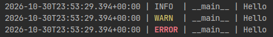
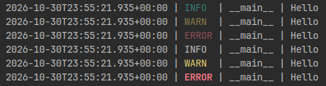
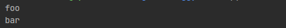
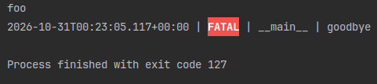
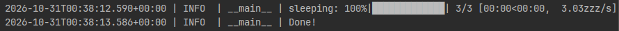
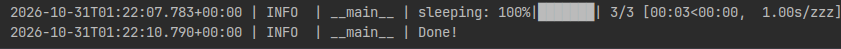
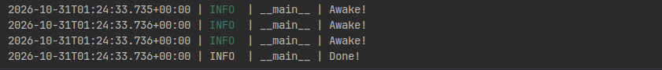
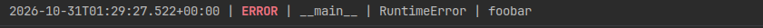

<h1>
    
    Loggy
</h1>

> Personal Python logging and utilities library. Feel free to use it or don't,
> this saves me time copy-pasting the same code between projects.
> There are many like it, but this one is mine.

## Features

- `INFO`, `DEBUG`, or automatic silent mode
- `tqdm` loading bar support for sync, async, threaded, or manual increments
- Write to log file
- Misc. util objects like timers

## Installation

```bash
pip install git+https://github.com/dlg1206/loggy.git
```

or add to `requirements.txt`

```txt
loggy @ git+https://github.com/dlg1206/loggy.git
```

## Overview

**Logging Modes**

- [Info](#info-mode)
- [Debug](#debug-mode)
- [Silent](#silent-mode)
- [Fatal](#fatal)

**Features**

- [tqdm Progress Bars](#async--threaded--manual-loading-bars)
- [Additional Logging Details](#additional-details)
- [Exception Logging](#exceptions)
- [Argparse](#argparse-support)
- [Config](#loggy-configs)

### `INFO` mode

```python
import loggy

loggy.info("Hello")
loggy.warn("Hello")
loggy.error("Hello")
```



### `DEBUG` mode

```python
import loggy
from loggy import Level

loggy.set_log_level(Level.DEBUG)  # or "debug"

loggy.debug_info("Hello")
loggy.debug_warn("Hello")
loggy.debug_error("Hello")
loggy.info("Hello")
loggy.warn("Hello")
loggy.error("Hello")
```



### `SILENT` mode

> All loggy output is silenced

```python
import loggy

loggy.set_log_level(None)  # "or Level.NONE or "none"

print("foo")
loggy.debug_info("Hello")
loggy.debug_warn("Hello")
loggy.debug_error("Hello")
loggy.info("Hello")
loggy.warn("Hello")
loggy.error("Hello")
print("bar")
```



### `Fatal`

> Program immediately exits with a non-zero code. Will print even if debug is set to silent.

```python
import loggy

print("foo")
loggy.fatal("goodbye")
print("bar")
```


Default exit code is `1` but can be set with `exit_code`:

```python
import loggy

print("foo")
loggy.fatal("goodbye", exit_code=127)
print("bar")
```



### Threaded / Async / Manual Loading Bars

> Integrated `tqdm` loading bars with loggy messages

#### `INFO` Mode

```python
import time
from concurrent.futures import ThreadPoolExecutor

import loggy

def sleep() -> str:
    time.sleep(1)
    return "Awake!"

with ThreadPoolExecutor() as exe:
    futures = [exe.submit(sleep) for _ in range(3)]
    for f in loggy.threaded_data_queue(futures, description="sleeping", unit="zzz"):
        result = f.result()
        # do extra processing here
        loggy.debug_info(result)

loggy.info("Done!")
```

```python
import asyncio

import loggy

async def sleep() -> str:
    await asyncio.sleep(1)
    return "Awake!"

async def main():
    futures = [asyncio.create_task(sleep()) for _ in range(3)]
    for f in loggy.async_data_queue(futures, description="sleeping", unit="zzz"):
        result = await f
        # do extra processing here
        loggy.debug_info(result)
    loggy.info("Done!")


if __name__ == '__main__':
    asyncio.run(main())
```



```python
import time

import loggy

def sleep() -> str:
    time.sleep(1)
    return "Awake!"

for _ in loggy.data_queue(range(3), description="sleeping", unit="zzz"):
    result = sleep()
    loggy.debug_info(result)

loggy.info("Done!")
```

```python
import time

import loggy

def sleep() -> str:
    time.sleep(1)
    return "Awake!"

bar = loggy.progress_bar(3, description="sleeping", unit="zzz")
for _ in range(3):
    result = sleep()
    loggy.debug_info(result)
    bar.update(1)
bar.close()

loggy.info("Done!")
```



#### `DEBUG` Mode

```python
import time
from concurrent.futures import ThreadPoolExecutor

import loggy
from loggy import Level

loggy.set_log_level(Level.DEBUG)  # <-- Set mode to debug

def sleep() -> str:
    time.sleep(1)
    return "Awake!"

with ThreadPoolExecutor() as exe:
    futures = [exe.submit(sleep) for _ in range(3)]
    for f in loggy.threaded_data_queue(futures, description="sleeping", unit="zzz"):
        result = f.result()
        # do extra processing here
        loggy.debug_info(result)

loggy.info("Done!")
```

```python
import asyncio

import loggy
from loggy import Level

loggy.set_log_level(Level.DEBUG)  # <-- Set mode to debug

async def sleep() -> str:
    await asyncio.sleep(1)
    return "Awake!"

async def main():
    futures = [asyncio.create_task(sleep()) for _ in range(3)]
    for f in loggy.async_data_queue(futures, description="sleeping", unit="zzz"):
        result = await f
        # do extra processing here
        loggy.debug_info(result)
    loggy.info("Done!")

if __name__ == '__main__':
    asyncio.run(main())
```

```python
import time

import loggy
from loggy import Level

loggy.set_log_level(Level.DEBUG)  # <-- Set mode to debug

def sleep() -> str:
    time.sleep(1)
    return "Awake!"

for _ in loggy.data_queue(range(3), description="sleeping", unit="zzz"):
    result = sleep()
    loggy.debug_info(result)

loggy.info("Done!")
```

```python
import time

import loggy
from loggy import Level

loggy.set_log_level(Level.DEBUG)  # <-- Set mode to debug

def sleep() -> str:
    time.sleep(1)
    return "Awake!"

bar = loggy.progress_bar(3, description="sleeping", unit="zzz")
for _ in range(3):
    result = sleep()
    loggy.debug_info(result)
    bar.update(1)
bar.close()

loggy.info("Done!")
```



### Additional Details

> Include additional details not embedded in the message, included by default. Supported by all methods

```python
import loggy

loggy.info("Hello", foo=True, bar="bazz")

# Disable additional details
loggy.info("Hello", emit_details=False, foo=True, bar="bazz")
```


### Exceptions

> Include exceptions in the details. Supported by warn, error, and fatal methods

```python
import loggy

try:
    raise RuntimeError("foobar")
except RuntimeError as e:
    loggy.error(e)
```



### Argparse Support

> Add to `argparse` command directly into `type` and `choices`

```python
import argparse
from loggy import Level

parser = argparse.ArgumentParser()
parser.add_argument(
    "--log-level",
    type=Level.from_string,
    choices=list(Level),
    # other args ...
)
```

### Loggy Configs

```python
import loggy

loggy.set_log_level()       # set the logging level
loggy.set_log_file()        # path to save logs to
loggy.set_tz()              # set timezone for log timestamps
loggy.set_output_stream()   # set the output stream
loggy.set_force_color()     # force ansi color codes to be used
```